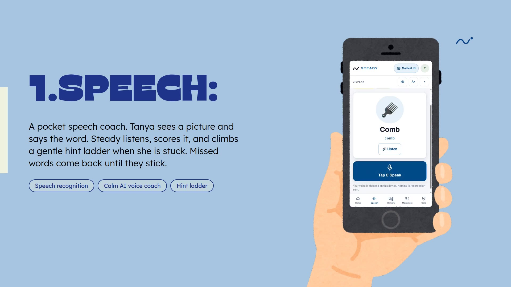
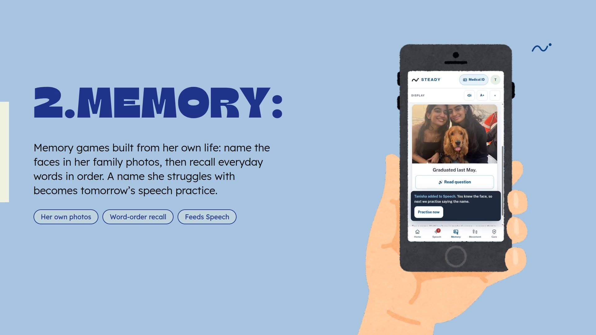
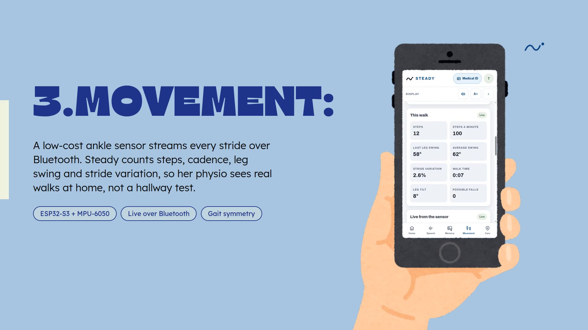
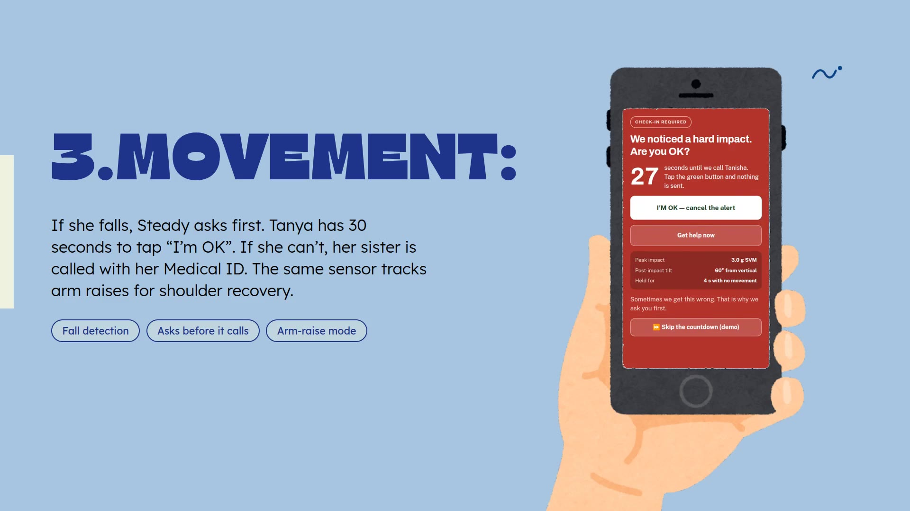
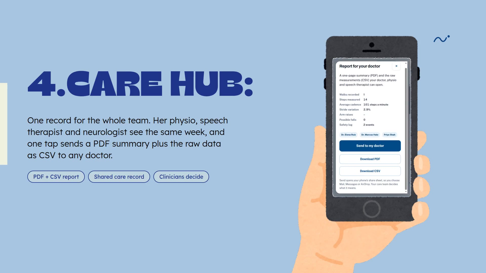

# Steady

**Post-stroke recovery, at home, together.** Steady is a phone app plus a **low-cost wearable motion sensor** that helps stroke survivors practise **speech** and **memory**, walk more evenly, and get help fast after a **fall**. It turns all of that into **one shared update for the patient, their family and their clinicians**.

> **Not another chatbot:** a **$10 wearable IMU on the ankle** feeds every stride into a **care-team report**, and **Claude** turns those measurements into a note the doctor can read in ten seconds and a message the family actually understands.

Built at **Cal Hacks 13.0** (October 23–25, 2026, Palace of Fine Arts, San Francisco).

**Try it on your phone:** https://mana.space/a/steady · **Demo video:** [`media/demo-tour.mp4`](media/demo-tour.mp4) · **Pitch deck:** [`deck/STEADY-pitch-deck.pdf`](deck/STEADY-pitch-deck.pdf)

| Speech | Memory | Movement | Fall check-in | Care report |
|---|---|---|---|---|
|  |  |  |  |  |

## Who it's for: Tanya

**Tanya, 34, is 11 weeks out from a left-side stroke.** (She is our composite user, built from published stroke-recovery statistics. Her family in the app, twin sister **Tanisha** and mother **Natasha**, are fictional.) She is home now. She gets about an hour of speech therapy a week, she sometimes can't find the word for "cup", she doesn't recognise a cousin in a photo straight away, her left leg drags, and she lives alone on weekdays. Her physio, her speech therapist and her neurologist each keep separate notes, and her family hears "she's doing fine."

**1 in 4 adults will have a stroke in their lifetime** (World Stroke Organization), and in the U.S. someone has a stroke **every 40 seconds** (CDC). After discharge most recovery happens **at home, between appointments**:

- **Speech:** about **1 in 3** survivors has aphasia; at home it is worksheets with no feedback.
- **Memory:** up to **60%** have memory or thinking problems in the first year; generic brain games drill strangers' faces.
- **Movement:** nearly **half** fall in their first year home; a fall button only works if you can press it.
- **Care:** nearly **1 in 4** strokes is a repeat stroke, and the people who could notice a change rarely see the same data.

## Bringing people closer together

Steady's Care tab is literally called **"Your people."** Recovery after a stroke is a **team sport played by people who rarely talk to each other**: the patient at home, the **family** who worries from a distance, and **clinicians** who see a snapshot once a week. Steady **connects all three around the same day-to-day data**. Tanya practises names of **her own family** in Memory (a name she struggles with becomes tomorrow's speech practice). Her sensor's walks and any fall alert go to **the person she chose**, with her Medical ID. One tap sends her **doctor** a PDF and the raw CSV, and Claude writes a **plain-language update she can share with family** ("Tanya walked 212 steps today; join her on the next walk"). Instead of isolating a patient with a screen, Steady **uses AI to bring her people back into her recovery**.

## How Claude is wired in

Claude runs **inside the product**, in the **Report for your doctor** sheet (Care → Send your progress):

1. Steady collects the report's own measurements (walks, steps, cadence, stride variation, symmetry, arm raises, possible falls, today's speech score) into one small JSON object.
2. **Claude Haiku 4.5** (Anthropic Messages API, called through Mana so no API key reaches the phone) gets that JSON with strict rules: **use only numbers in the data, describe and never interpret, never diagnose or recommend treatment, label demo data as demo**.
3. It returns **two audiences from one source of truth**:
   - **For the care team:** three factual bullets, which also go at the top of the **PDF**.
   - **For family:** a warm, plain-language update with one way to spend time together, shared via the phone's share sheet.
4. **Every number Claude writes is checked against the data it was given.** If any number doesn't match, or Claude is slow (14 s) or offline, Steady silently uses its own template sentences instead, and the sheet says which one you're reading ("drafted by Claude" vs "written by Steady").

Code: [`app/index.html`](app/index.html) (search `careNotes`, `numbersOk`, `CARE_SYSTEM`) and [`app/mana-bridge.jsx`](app/mana-bridge.jsx) (the `claude` handler).

## Failure modes and safeguards

| What can go wrong | What Steady does |
|---|---|
| **Claude invents or changes a number** | Every number in its output must appear in the input data, or the note is replaced by Steady's template. Prompt forbids diagnosis, risk judgement and treatment advice. The PDF labels the summary "drafted by Claude, not a clinical interpretation." |
| **Claude is unavailable or slow** | 14-second timeout, then template sentences; the report, PDF and CSV never depend on Claude. |
| **Speech is mis-heard** | The attempt is transcribed (ElevenLabs Scribe) and matched with word-level fuzzy matching (exact phrase, or ≥ 80% similar; names ≥ 72%). Steady shows what it heard, so the patient sees why. No sound is never counted as wrong. |
| **False fall alert** (sitting with the leg crossed, dropping the sensor) | Every alert **asks first**: 30 seconds to tap "I'm OK" before anyone is called. Near-falls are logged, not escalated. |
| **Missed fall** (sensor off, battery dead, out of range) | The sensor reports "contact lost"; Steady shows the stream as stale after 5 s. Steady is **not a replacement for a medical alert device**, and says so. |
| **iPhones can't use Web Bluetooth** | The connected laptop or Android phone relays the live stream to every phone in real time. |
| **Wrong conclusions from demo data** | Speech-latency history and weekly trend rows are labelled **demonstration data** in the app, PDF, CSV and in what Claude is told. |
| **Privacy** | Speech audio is only transcribed to check the word and is not saved. Reports leave the phone only through the share sheet, to people the patient chooses. Demo patient data is synthetic. |

Steady measures, prompts and routes. **A licensed clinician makes every clinical decision.** This is a hackathon prototype, not a medical device. Not affiliated with Kaiser Permanente.

## What Steady does

1. **Speech:** a picture-naming coach. You see a picture, tap, and say the word. Your attempt is transcribed (**ElevenLabs Scribe**) and Steady tells you one thing: **correct, or not quite** (with what it heard). A calm voice coach (ElevenLabs TTS) can say the word first.
2. **Memory:** two short games built from **your own life**: name the people in your family photos, and recall everyday words in order.
3. **Movement:** an **ESP32-S3 + MPU-6050** sensor streams every stride over **Bluetooth Low Energy**. Steady counts steps, cadence, leg swing, stride-time variation, and **left/right symmetry** with one sensor on each leg. Arm-raise mode tracks shoulder range.
4. **Fall check-in:** if the leg stays tipped over, Steady **asks first**, then calls your emergency contact with your Medical ID.
5. **Care hub ("Your people"):** contacts and care team in one place; one tap sends a **PDF summary plus raw CSV** (every stride and arm raise), with Claude's care-team note and family update.

## Repository

```
app/index.html                 The Steady phone app (single file: HTML, CSS, JS). Opens in any browser.
app/mana-bridge.jsx            The Mana component that hosts the app: live sensor relay to other phones, saved sessions,
                               ElevenLabs voice + speech-to-text, and Claude for the care-team note.
firmware/neurosync_ble/        ESP32-S3 firmware (Arduino): MPU-6050 over I2C, BLE Nordic UART service.
tools/neurosync_ble.html       Stand-alone Web Bluetooth console for the sensor.
tools/neurosync_receiver.py    Laptop receiver (Python + bleak) for one or two sensors.
docs/ble-protocol.md           The sensor's message and command format.
media/                         Demo videos and screenshots.  deck/  Pitch deck.
```

## Run it

**Phone (easiest):** open https://mana.space/a/steady. The first screen asks for the microphone and tests speech and the voice coach.

**Locally:** open `app/index.html` in Chrome (or `python3 -m http.server` and visit `http://localhost:8000/app/`). On its own the app uses the browser's speech recognition and voice, keeps sessions in local storage, and writes the report notes from templates (Claude, ElevenLabs and the live relay need the Mana host).

**Sensor:**
1. Wire an MPU-6050 to an ESP32-S3: SDA → GPIO 8, SCL → GPIO 9, VCC → 3V3, GND → GND.
2. Flash `firmware/neurosync_ble/neurosync_ble.ino` with the Arduino IDE (board: ESP32S3 Dev Module). It advertises as `NeuroSync-Ankle` (use `NeuroSync-Left` / `NeuroSync-Right` for two sensors).
3. In Steady, open **Movement → Connect by Bluetooth** (Chrome on Android or a laptop), or **Connect by USB** at 115200 baud.
4. Stand still → **Calibrate** → **Start walk**. Strap it to the outside of the weaker leg, just above the ankle.

Only one program can connect to the sensor at a time: close `tools/neurosync_ble.html` and `neurosync_receiver.py` first.

## How it's built

- **Hardware:** ESP32-S3 + MPU-6050 6-axis IMU; on-device stride detection, arm-raise peaks and tilt-based fall detection; BLE notifications ≤ 20 bytes.
- **App:** vanilla HTML/CSS/JS, phone-first and accessible (bigger text, stronger contrast, read-aloud).
- **Web Bluetooth / Web Serial** to talk to the sensor from the browser.
- **Claude Haiku 4.5** (Anthropic) for the grounded care-team note and family update.
- **ElevenLabs:** Scribe v2 speech-to-text, `eleven_v4_turbo` calm voice coach (clips cached).
- **Mana** (mana.space): hosting, real-time relay of the sensor stream to every phone (Firebase Realtime Database), saved sessions, and a server-side proxy for Anthropic and ElevenLabs so no key reaches the browser.
- **Reports:** jsPDF, a tidy CSV (`date,time,category,measure,value,unit,session,note`), Web Share API.

## Team

Jack Langhoff (Movement) · Maya Van (Care Hub) · Miriya Mayenkar (Memory) · Tanya Hemdev (Speech)

## Acknowledgements

Built during Cal Hacks 13.0 with help from AI coding assistants (Claude, Mana). Statistics: World Stroke Organization; CDC Stroke Facts (2024); Flowers et al., *Arch Phys Med Rehabil* 2016; AHA/ASA Scientific Statement on post-stroke cognitive impairment (2023); Walsh et al., FREESE cohort (2018).

## License

MIT
